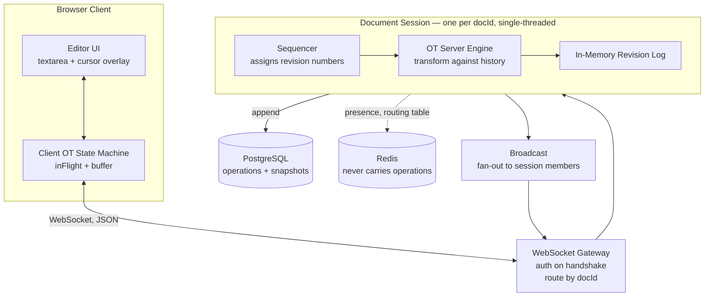
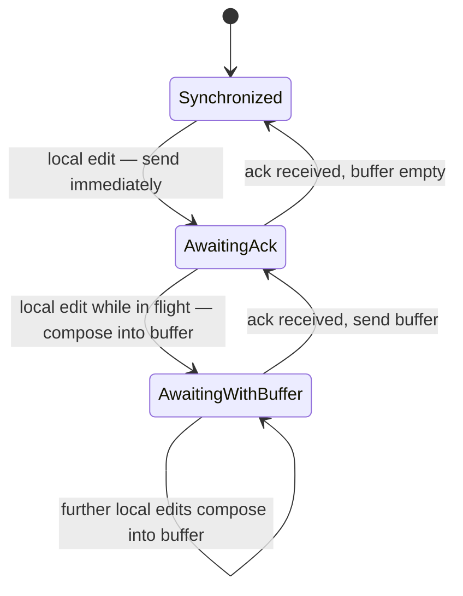

# Real-Time Collaborative Text Editor — Design Document

**Status:** Draft v0.1 — pre-implementation
**Author:** Abhi
**Last updated:** 2026-08-22

---

## 1. Goals and Non-Goals

### Goals

1. Multiple users edit one plain-text document simultaneously, with no page refresh.
2. All replicas **converge** on identical content regardless of network ordering or latency.
3. Local edits appear **instantly** (optimistic application), never blocked on a server round trip.
4. Correctness is **provable**, not merely observed — verified by property-based testing.
5. Survive client disconnect and reconnect without divergence or lost work.

### Non-Goals (explicitly out of scope for v1)

| Excluded | Reason |
|---|---|
| Rich text, formatting, embedded media | Multiplies OT complexity, proves nothing extra |
| `contenteditable` / rich editor integration | Browser quirk rabbit hole; a `<textarea>` proves the same thing |
| Undo / redo | Requires operation inversion against a moving history — a project in itself |
| Peer-to-peer / offline-first sync | Would require TP2, which is where OT gets genuinely hard |
| Access control beyond a simple owner check | Not the point of this project |
| Kafka, service mesh, multi-region | Resume padding at this scale |

### Explicit Design Constraint

> **Every operation for a given document is processed by exactly one thread, in one total order.**

This is not a performance decision. It is the precondition that makes OT tractable, and every
architectural choice below is downstream of it.

---

## 2. Key Decisions

| # | Decision | Alternative Considered | Rationale |
|---|---|---|---|
| D1 | Operational Transformation | CRDT (Yjs / Automerge) | OT forces explicit reasoning about causality and convergence. CRDTs hide it inside the data structure. Learning goal wins. |
| D2 | Central server, client/server asymmetry (Jupiter model) | Peer-to-peer OT | Server-centric means only **TP1** must hold. TP2 is required for P2P and is where most published OT algorithms were later found to be incorrect. |
| D3 | Raw WebSocket + JSON frames | STOMP / Spring Messaging | STOMP abstracts away the ordering and acknowledgement semantics that are the substance of this project. |
| D4 | Document affinity routing (`hash(docId) → instance`) | Relay operations via Redis pub/sub | Pub/sub is at-most-once with no ordering guarantee. A single dropped operation causes **permanent** divergence. |
| D5 | Postgres as the operation log | Redis Streams / Kafka | Streams and Kafka are correct alternatives but add a hop without removing the affinity requirement. Postgres is sufficient at this write volume. |
| D6 | Positional ops (`Insert`/`Delete`) in v1, retain-based deltas in v2 | Retain/insert/delete deltas from day one | Positional ops make the transform case analysis learnable. Deltas are the production form; upgrade after the simple version is proven. |
| D7 | Character-level, string-capable operations | Character-only | String inserts and range deletes are what a real editor emits. Overlapping range deletes are the interesting transform case. |

---

## 3. Architecture

### 3.1 Component View



### 3.2 Responsibilities

| Component | Owns | Does NOT own |
|---|---|---|
| Editor UI | DOM, caret, rendering remote cursors | Any transform logic |
| Client OT State Machine | `inFlight`, `buffer`, local revision | Assigning revision numbers |
| WebSocket Gateway | Handshake auth, connection registry, JSON codec | Document state |
| Document Session | Authoritative content, revision counter, member list | Cross-document concerns |
| OT Engine | `apply`, `transform`, `compose` — pure functions | I/O, threading, Spring |
| PostgreSQL | Durable op log, snapshots | Live coordination |
| Redis | Presence, `docId → instance` routing table | **Operations. Ever.** |

### 3.3 Thread Model

- Netty event loop threads accept WebSocket frames and deserialise them. **No document state is touched here.**
- Each active document owns one `Scheduler` from `Schedulers.newSingle()` (or a single-thread executor). All mutation happens there.
- Fan-out uses a `Sinks.Many<ServerMessage>` per document, `multicast().onBackpressureBuffer()`.
- Operations are immutable Java `record`s. A transformed operation is always a new object; log entries are never mutated.

---

## 4. Operation Model

### 4.1 Types

```java
public sealed interface Operation permits Insert, Delete, NoOp {}

public record Insert(int position, String text) implements Operation {}
public record Delete(int position, int length)  implements Operation {}
public record NoOp()                            implements Operation {}
```

`NoOp` is a valid operation with no components — the identity edit. It exists so a transform whose
result changes nothing (the full-containment and identical-range delete overlaps, §5.3 cases 11 and
13) has an explicit value to return instead of `null`.

`position()` is deliberately **not** on the `Operation` interface — it is an accessor on `Insert`
and `Delete` only. Nothing dispatches on it polymorphically (`apply`, `transform`, and
serialisation all switch on the concrete type first), so it carried no weight on the interface while
forcing `NoOp` to invent a position it does not have.

### 4.2 Operation Envelope

Every operation on the wire carries its **parentage** — the revision it was authored against.
Without this, compound OT is impossible.

```java
public record OperationEnvelope(
    UUID     clientOpId,   // client-generated; used for idempotency and self-recognition
    UUID     documentId,
    UUID     authorId,
    long     baseRevision, // revision this op was authored against
    Operation op
) {}
```

### 4.3 Core Functions — signatures you will implement

```java
// Applies op to state. Throws if op is out of bounds for state.
String apply(String state, Operation op);

// TP1: apply(apply(S, a), bPrime) == apply(apply(S, b), aPrime)
record TransformResult(Operation aPrime, Operation bPrime) {}
TransformResult transform(Operation a, Operation b);

// apply(apply(S, a), b) == apply(S, compose(a, b))
Operation compose(Operation a, Operation b);
```

**`NoOp` is absorbing under `transform`.** For any `x`, `transform(NoOp, x).aPrime() == NoOp`, and
symmetrically `transform(x, NoOp).bPrime() == NoOp` — a dead operation can never revive. The other
side is returned unchanged, since transforming against a `NoOp` changes nothing. This must be
asserted alongside TP1.

**Note on `compose` with positional ops:** two arbitrary positional operations do not always compose
into a single positional operation. v1 therefore models the client buffer as an
`OperationSequence` (an ordered list) and defines `compose` as concatenation-with-merge, merging
only adjacent compatible ops. Moving to retain-based deltas in v2 makes `compose` total. **This is
the main reason v2 exists.**

---

## 5. Conflict Resolution

### 5.1 The Property Being Guaranteed

**TP1 (Transformation Property 1):**

```
apply(apply(S, a), b') == apply(apply(S, b), a')
    where (a', b') = transform(a, b)
```

Given a shared starting state `S` and two concurrent operations, transforming each against the
other yields a pair that reconverges. This is the *only* property required in a server-centric
design.

**TP2** — `transform(transform(c, a), b') == transform(transform(c, b), a')` — is **not required**
here, because the server imposes a total order and no client ever transforms against two
independently-ordered histories. Documented so the omission is understood as deliberate.

### 5.2 The Diamond

```mermaid
graph TD
    S["S — shared state"]
    LA["apply(S, a)"]
    LB["apply(S, b)"]
    C["Converged state"]
    S -->|a| LA
    S -->|b| LB
    LA -->|b' = transform(a,b).bPrime| C
    LB -->|a' = transform(a,b).aPrime| C
```

OT solves exactly one thing: **given the top two edges, derive the bottom two.** Everything
else in this document exists to reduce real situations to this diamond.

### 5.3 Transform Case Table — WORKSHEET

> **This table is deliberately incomplete. Filling it in is milestone M0 and must be done by hand
> before any code is written.** For each case, write the resulting `(a', b')` and, in the notes
> column, the one-sentence justification.

Notation: `I(p, s)` = insert string `s` at position `p`; `D(p, n)` = delete `n` chars from position `p`.

| # | a | b | Condition | a' | b' | Notes |
|---|---|---|---|---|---|---|
| 1 | `I(pa, sa)` | `I(pb, sb)` | `pa < pb` | `I(pa, sa)` | `I(pb + len(sa), sb)` | `a` is left of `b`, so `b` doesn't move it; `a` inserts `len(sa)` before `pb`, pushing `b` right. |
| 2 | `I(pa, sa)` | `I(pb, sb)` | `pa > pb` | `I(pa + len(sb), sa)` | `I(pb, sb)` | Mirror of case 1. |
| 3 | `I(pa, sa)` | `I(pb, sb)` | `pa == pb` | `I(pa, sa)` | `I(pb + len(sa), sb)` | **Tie-break (Q1 → positional priority):** `a`'s text is placed left of `b`'s, collapsing this into case 1 (condition becomes `pa <= pb`). |
| 4 | `I(pa, sa)` | `D(pb, nb)` | `pa <= pb` | `I(pa, sa)` | `D(pb + len(sa), nb)` | Insert at/before the delete: unmoved; delete slides right by `len(sa)`. |
| 5 | `I(pa, sa)` | `D(pb, nb)` | `pa >= pb + nb` | `I(pa - nb, sa)` | `D(pb, nb)` | Insert after the delete: slides left by `nb`; delete unmoved. |
| 6 | `I(pa, sa)` | `D(pb, nb)` | `pb < pa < pb + nb` | `NoOp` | `D(pb, nb + len(sa))` | **Q2 → drop in v1.** A single `Delete` can't skip the insert (it would need two ranges), so the delete swallows it and `a'` dies. Preserve returns in v2's retain model. |
| 7 | `D(pa, na)` | `I(pb, sb)` | mirror of 4–6 | see note | see note | **DI quadrant (mirror of 4–6):** `pb <= pa` → `a'=D(pa+len(sb), na)`, `b'=I(pb, sb)`; `pb >= pa+na` → `a'=D(pa, na)`, `b'=I(pb-na, sb)`; `pa < pb < pa+na` → `a'=D(pa, na+len(sb))`, `b'=NoOp`. |
| 8 | `D(pa, na)` | `D(pb, nb)` | disjoint, `a` before `b` | `D(pa, na)` | `D(pb - na, nb)` | b is right of a; a unmoved, b shifts left by na. |
| 9 | `D(pa, na)` | `D(pb, nb)` | disjoint, `b` before `a` | `D(pa - nb, na)` | `D(pb, nb)` | Mirror of 8. |
| 10 | `D(pa, na)` | `D(pb, nb)` | `a` fully contains `b` | `D(pa, na - nb)` | `NoOp` | b's chars are inside a's range; deleted-once → `b'` dies, a shrinks by nb. |
| 11 | `D(pa, na)` | `D(pb, nb)` | `b` fully contains `a` | `NoOp` | `D(pb, nb - na)` | Mirror of 10 — `a'` is the no-op. |
| 12 | `D(pa, na)` | `D(pb, nb)` | partial overlap | see note | see note | **Deleted-once.** a-first (`pa<pb`): `a'=D(pa, pb-pa)`, `b'=D(pa, (pb+nb)-(pa+na))`. b-first (`pb<pa`): `a'=D(pb, (pa+na)-(pb+nb))`, `b'=D(pb, pa-pb)`. Each deletes only its non-overlapping part; the intersection goes once. |
| 13 | `D(pa, na)` | `D(pb, nb)` | identical ranges | `NoOp` | `NoOp` | Both target the same chars; deleted once, both sides vanish. |

**Tie-break convention (Q1).** `transform` uses *positional priority*: in `transform(a, b)`, `a` is
the lower-priority side, and on a same-position insert its text is placed to the left. The operation
carries no id; the caller passes arguments in a consistent priority order (the server transforms an
incoming op against already-sequenced ops, which supplies that order). `transform(b, a)` is thus the
mirror of `transform(a, b)`, not identical.

**Delete/Delete unifies (cases 8–13).** All six collapse into one rule. Let
`ovl = max(0, min(pa+na, pb+nb) − max(pa, pb))` be the overlap length. Then `a'` deletes `na − ovl`
characters (a `NoOp` when that is 0) starting at `pa` shifted left by however many of `b`'s deleted
characters lay before `pa`; `b'` is symmetric. Deleted-once falls out of subtracting `ovl` from both
lengths, so the shared characters are removed exactly once.

Cases 6, 11, 12 are where intention preservation and mere convergence come apart. A wrong answer
here can still converge while destroying user intent.

### 5.4 Server Control Algorithm

Invariant: **the server never tracks per-client state beyond the last acknowledged revision.**

```
onOperation(envelope):
    if envelope.baseRevision > currentRevision:  reject (client is from the future)
    if envelope.baseRevision < oldestRetainedRevision: force full resync

    if seenClientOpIds.contains(envelope.clientOpId):
        resend the existing ack        // idempotent replay after reconnect
        return

    concurrentOps = log.slice(envelope.baseRevision, currentRevision)
    op = envelope.op
    for each c in concurrentOps:
        op = transform(op, c).aPrime

    content = apply(content, op)
    currentRevision += 1
    log.append(currentRevision, op, envelope.clientOpId, envelope.authorId)
    persistAsync(currentRevision, op)

    broadcast to all session members:
        { type: "op", revision: currentRevision, op, authorId, clientOpId }
```

The author receives its own transformed operation back, identified by `clientOpId`. That echo
**is** the acknowledgement — no separate ack message is needed. This keeps the server stateless
per client.

**The no-op case is not special-cased.** When the transform loop reduces `op` to `NoOp` (a
full-containment or identical-range delete overlap), it flows through the exact path above: `apply`
leaves `content` unchanged, `currentRevision` still increments, the `NoOp` is appended to the log,
and it is broadcast as an ordinary `op` message. Revision numbers order *events*, not text changes.
One message type is one code path — the author's acknowledgement arrives through the normal
broadcast (its `clientOpId` echoed) with no new client state transition, and every other client is
informed for free. The log becomes a record of what *happened*, not only what changed.

Rejected: a dedicated `opDiscarded` message sent to the author only. Leaner on storage, but it
needs a second server code path, a second client handler, and a strict ordering constraint — it must
arrive after every broadcast up to that revision, or the client clears `inFlight` while holding
stale text. Not worth it.

### 5.5 Client Control Algorithm

Three states. This is the hardest code in the project.



**Invariant: at most ONE operation in flight at any time.** The client may not send its buffer
until the in-flight operation is acknowledged, because until then it does not know where in
server state space the buffer is parented.

> Common mistake: modelling the client as holding a *queue* of pending operations. It holds two
> slots — `inFlight: Operation?` and `buffer: Operation?` — and nothing else.

Handling each event:

| Event | Synchronized | AwaitingAck | AwaitingWithBuffer |
|---|---|---|---|
| Local edit | apply locally, send, → AwaitingAck | apply locally, `buffer = op`, → AwaitingWithBuffer | apply locally, `buffer = compose(buffer, op)` |
| Remote op | apply directly | `(op', inFlight') = transform(op, inFlight)`; apply `op'`; store `inFlight'` | transform against `inFlight` **then** against `buffer`; apply result; update both |
| Ack (own op echoed) | — (error) | → Synchronized | send `buffer`, `inFlight = buffer`, `buffer = null`, → AwaitingAck |

---

## 6. Wire Protocol

JSON over a single WebSocket connection. One connection may join multiple documents.

### Client → Server

```jsonc
{ "type": "join",   "documentId": "uuid" }
{ "type": "leave",  "documentId": "uuid" }

{ "type": "op",
  "documentId": "uuid",
  "clientOpId": "uuid",
  "baseRevision": 42,
  "op": { "kind": "insert", "position": 12, "text": "hello" } }

{ "type": "cursor",
  "documentId": "uuid",
  "baseRevision": 42,
  "anchor": 12, "head": 17 }
```

### Server → Client

```jsonc
{ "type": "sync",
  "documentId": "uuid",
  "revision": 42,
  "content": "full document text",
  "participants": [ { "userId": "...", "displayName": "...", "colour": "#..." } ] }

{ "type": "op",
  "documentId": "uuid",
  "revision": 43,
  "clientOpId": "uuid",       // if this matches one you sent, it is your ACK
  "authorId": "uuid",
  "op": { "kind": "delete", "position": 9, "length": 3 } }

{ "type": "op",                 // a NoOp payload: the server reduced an op to nothing (§5.4)
  "documentId": "uuid",
  "revision": 44,
  "clientOpId": "uuid",
  "authorId": "uuid",
  "op": { "kind": "noop" } }

{ "type": "cursor",  "documentId": "uuid", "userId": "uuid", "anchor": 12, "head": 17 }
{ "type": "presence","documentId": "uuid", "joined": [...], "left": [...] }
{ "type": "error",   "documentId": "uuid", "code": "REVISION_TOO_OLD", "message": "..." }
```

### Error Codes

| Code | Meaning | Client action |
|---|---|---|
| `REVISION_TOO_OLD` | Base revision predates retained history | Discard local state, request `sync` |
| `REVISION_FROM_FUTURE` | Base revision exceeds server's | Bug — log and resync |
| `INVALID_OPERATION` | Op out of bounds for its base state | Bug — log and resync |
| `NOT_AUTHORISED` | No access to document | Close connection |

---

## 7. Database Design

### 7.1 Schema

```sql
CREATE TABLE documents (
    id                UUID PRIMARY KEY,
    title             TEXT        NOT NULL DEFAULT 'Untitled',
    owner_id          UUID        NOT NULL,
    current_revision  BIGINT      NOT NULL DEFAULT 0,
    created_at        TIMESTAMPTZ NOT NULL DEFAULT now(),
    updated_at        TIMESTAMPTZ NOT NULL DEFAULT now()
);

-- Append-only. Rows are NEVER updated or deleted (except by retention compaction).
-- The composite primary key is what enforces the gapless total order per document.
CREATE TABLE operations (
    document_id   UUID        NOT NULL REFERENCES documents(id) ON DELETE CASCADE,
    revision      BIGINT      NOT NULL,
    client_op_id  UUID        NOT NULL,
    author_id     UUID        NOT NULL,
    payload       JSONB       NOT NULL,   -- the TRANSFORMED op, as applied to server state
    created_at    TIMESTAMPTZ NOT NULL DEFAULT now(),
    PRIMARY KEY (document_id, revision)
);

-- Idempotency: a replayed operation after reconnect must not apply twice.
CREATE UNIQUE INDEX ux_operations_client_op
    ON operations (document_id, client_op_id);

CREATE TABLE document_snapshots (
    document_id   UUID        NOT NULL REFERENCES documents(id) ON DELETE CASCADE,
    revision      BIGINT      NOT NULL,
    content       TEXT        NOT NULL,
    created_at    TIMESTAMPTZ NOT NULL DEFAULT now(),
    PRIMARY KEY (document_id, revision)
);

CREATE TABLE document_participants (
    document_id  UUID NOT NULL REFERENCES documents(id) ON DELETE CASCADE,
    user_id      UUID NOT NULL,
    role         TEXT NOT NULL CHECK (role IN ('owner','editor','viewer')),
    added_at     TIMESTAMPTZ NOT NULL DEFAULT now(),
    PRIMARY KEY (document_id, user_id)
);
```

### 7.2 Design Notes

**Store the transformed operation, not the original.** Replay must reproduce the exact server
state. The op as the client authored it is meaningless without its concurrent context; the op as
applied is self-contained.

**`(document_id, revision)` as primary key** is doing real work — it makes gaps and duplicate
revision numbers impossible at the storage layer, not just in application code.

**Snapshots every N operations** (start with N = 500). Loading a document:

```
snapshot = SELECT * FROM document_snapshots
           WHERE document_id = ? ORDER BY revision DESC LIMIT 1;
ops      = SELECT * FROM operations
           WHERE document_id = ? AND revision > snapshot.revision ORDER BY revision;
content  = ops.fold(snapshot.content, apply);
```

**Retention.** Operations older than the second-most-recent snapshot may be pruned. Keep at least
two snapshots so an in-flight client with a stale `baseRevision` can usually still be served
rather than force-resynced.

### 7.3 Storage Budget

The hosted target is Neon's free tier: **0.5 GB per project**. This turns retention from an
optimisation into a requirement, and it constrains the schema.

Rough sizing: an `operations` row is ~150 bytes with its JSONB payload and indexes. 0.5 GB is
therefore on the order of 3M operations — reachable by a single enthusiastic demo session left
running. A `document_snapshots` row costs the full document length, so snapshotting too often is
the more likely way to exhaust the budget.

Consequences, all of which are already in the schema but now have a reason:

- **Compaction is mandatory, not optional.** Prune operations older than the second-most-recent
  snapshot on a schedule, not on a whim.
- **Snapshot interval is a storage decision as much as a load-time one.** N = 500 is the starting
  point; raise it if snapshot rows dominate.
- Keep exactly two snapshots per document. The older one exists so a client with a stale
  `baseRevision` can usually be served from history rather than force-resynced.
- Add a monitored metric for total `operations` row count per document. Hitting the storage cap
  suspends the database, which presents as total unexplained failure.
- **`NoOp` rows still cost storage.** A transform that reduces to `NoOp` is logged and broadcast on
  the normal path (§5.4), so it counts against the budget like any op. These arise only from
  full-containment and identical-range delete overlaps (§5.3 cases 11 and 13), which should be rare
  in real editing — instrument the rate (see §11) rather than guessing. Because they are provably
  no-ops, compaction may drop them during snapshot rollup without changing any replay.

### 7.4 Write Path — Open Decision

Two options, tradeoff to be recorded once measured:

| Approach | Latency impact | Crash behaviour |
|---|---|---|
| **Synchronous append** before broadcast | Adds a DB round trip to every keystroke | No operation is ever acknowledged without being durable |
| **Write-behind** (broadcast first, batch-append async) | No added latency | A crash can lose acknowledged operations; clients diverge from the persisted log |

**Provisional choice:** synchronous append for v1 — correctness first, and Postgres will handle the
volume of a demo comfortably. Revisit only if measurement shows a problem. Record the measurement
in this document when it happens.

---

## 8. Scale-Out (design now, build last)

Because OT requires one writer per document, horizontal scaling means **routing the connection,
not the operation**.

- Consistent hash on `documentId` selects the owning instance.
- Routing table lives in Redis as `doc:{id} → instance` with a TTL renewed by heartbeat.
- Ownership is claimed with `SET NX` on first join.
- Redis pub/sub carries **presence and cursors only** — both are lossy-tolerant because they are
  re-broadcast continuously and can be recomputed.

**Rejected: relaying operations over Redis pub/sub.** At-most-once delivery with no ordering
guarantee means a single dropped frame causes permanent, unrecoverable divergence. Redis Streams
or Kafka would be correct alternatives, but both still require a single writer to assign revision
numbers, so neither removes the affinity requirement — they only add a hop.

---

## 9. Testing Strategy

This section is what makes the project credible. It is not optional.

### 9.1 Property-Based Convergence Test (jqwik)

```java
@Property(tries = 10_000)
void tp1Holds(@ForAll("documents") String s,
              @ForAll("opsFor") Operation a,
              @ForAll("opsFor") Operation b) {
    var t = transform(a, b);
    assertThat(apply(apply(s, a), t.bPrime()))
        .isEqualTo(apply(apply(s, b), t.aPrime()));
}
```

Also assert:
- `apply(apply(s, a), b) == apply(s, compose(a, b))` (composition law)
- Transform mirrors under argument swap: `transform(a, b) == (a', b')` implies `transform(b, a) == (b', a')` (positional priority, §5.3)
- No transform result ever produces an out-of-bounds operation
- `NoOp` is absorbing under transform: `transform(NoOp, x).aPrime()` and `transform(x, NoOp).bPrime()` are always `NoOp` — a dead operation never revives

### 9.2 Randomised Multi-Client Simulation

Simulate N in-memory clients against an in-memory server with randomised latency and message
reordering. After the run drains, assert every client's content equals the server's. Run with a
fixed seed in CI, random seeds locally.

### 9.3 Reconnection Fuzzing

Randomly kill and restore client connections mid-stream; assert convergence after settle.

### 9.4 Target for the README

> Convergence verified by property-based testing over 10⁶ generated operation pairs, plus a
> randomised 8-client simulation with injected latency, reordering, and disconnects.

---

## 10. Milestones

| ID | Deliverable | Written by | Definition of Done |
|---|---|---|---|
| **M0** | This document, with §5.3 fully filled in by hand | Abhi | Every case in the transform table has a result and a justification |
| **M1** | WebSocket transport skeleton, echo only | CLI | Two browser tabs echo text; no OT |
| **M2** | `ot-core` module — pure Java, zero Spring | **Abhi** | jqwik TP1 property passes at 10⁶ tries |
| **M3** | Server control algorithm + revision log | **Abhi** | Two clients converge under simulated latency |
| **M4** | Client three-state machine | **Abhi** | Fast typing during high latency still converges |
| **M5** | Postgres persistence + snapshots | Split | Restart the server; documents reload intact |
| **M6** | Cursors and presence | **Abhi** | Remote cursors shift correctly on remote edits |
| **M7** | Reconnection with op replay | **Abhi** | Kill the network for 30s mid-edit; converges on restore |
| **M8** | Multi-instance affinity routing | Optional | Two instances, one document, correct convergence |

### Division of Labour

`CLAUDE.md` at repo root must contain:

```
Do not create or modify any file under ot-core/ or client/src/ot/.
If a task requires changes there, stop and describe what is needed instead.
```

**CLI writes:** Spring scaffolding, WebSocket wiring, DTOs and Jackson config, R2DBC entities and
repositories, Flyway migrations, React shell, Docker Compose, CI, test scaffolding (structure only,
not assertions), load-test harness.

**Abhi writes:** everything in `ot-core/` and `client/src/ot/` — `apply`, `transform`, `compose`,
the server control loop, the client state machine, cursor transformation, and every test assertion.

---

## 11. Open Questions

| # | Question | Resolve by |
|---|---|---|
| Q1 | Tie-break rule for same-position inserts — **resolved: positional priority.** In `transform(a, b)`, `a`'s text is placed left of `b`'s; the caller passes args in a consistent priority order, so no id lives on the op. | Resolved (M2) |
| Q2 | Insert inside a deleted range (case 6) — **resolved: drop in v1.** A single positional `Delete` can't skip the insert (it would need two ranges), so v1 lets the delete swallow it (`a'=NoOp`, delete grows by `len(sa)`); preserve returns in v2's retain-based model. | Resolved (M2) |
| Q3 | Does `compose` need to be total in v1, or is `OperationSequence` acceptable? | M2 |
| Q4 | Synchronous vs write-behind persistence — measure before deciding permanently | M5 |
| Q5 | Retention window before compaction — bounded by the 0.5 GB cap in §7.3, not by preference | M5 |
| Q6 | Cursor transform — reuse `transform` with a zero-length op, or a separate function? | M6 |
| Q7 | Observed rate of `NoOp` operations in real editing — low enough that logging them is negligible against the §7.3 budget, or does it justify compacting no-op rows at snapshot rollup? | Measure at M5 |

---

## 12. References

| Resource | Use |
|---|---|
| Spiewak, *Understanding and Applying Operational Transformation* (codecommit.com) | **Primary.** The only source covering compound OT and the buffer invariant. |
| Nichols et al., *Jupiter Collaboration System* (1995), doi 10.1145/215585.215706 | The architecture being implemented |
| Sun, *OT FAQ*, www3.ntu.edu.sg/scse/staff/czsun/projects/otfaq/ | Reference for CCI, TP1/TP2 — consult, do not read linearly |
| Baumann, OT visualisation, operational-transformation.github.io/visualization.html | Intuition for state-space divergence |
| ot.js, github.com/Operational-Transformation/ot.js | Read `client.js` and `text-operation.js` — then close and write your own |
| Kleppmann, *Designing Data-Intensive Applications*, ch. 5 | Causality, happens-before, concurrent writes |
