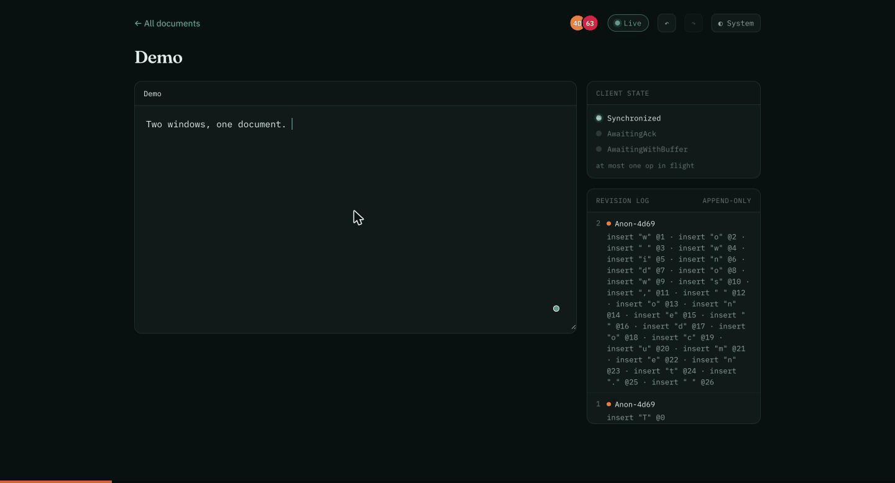

# otter

A real-time collaborative plain-text editor built on a **hand-written Operational Transformation
(OT) engine** — no Yjs, ShareDB, or Automerge. Two people edit the same document at once; concurrent
edits are transformed so every client converges on byte-identical text.

Java 21 · Spring WebFlux (reactive, raw WebSockets) · PostgreSQL (R2DBC) · React + TypeScript.

**Live demo: https://otter-live.netlify.app** — create a document and share its link to edit together.
(The free backend sleeps when idle, so the first load may take ~30–60s to wake.)

<!-- Record this: two browser windows typing into the same document at the same time. -->
<!-- See "Recording the demo" below. -->


## Features

- **Real-time collaborative editing** — multiple people edit one document over WebSockets; concurrent
  inserts and deletes are transformed so every client ends up byte-for-byte identical.
- **Multiple documents** — create, list, open, and rename documents; each has a shareable URL
  (`/d/<id>`), and the home screen is a searchable card/list grid.
- **Presence & remote cursors** — see who is in a document and where their caret *and selection* are,
  shifting live as the text changes beneath them.
- **Selective undo / redo** — `Ctrl`/`Cmd`+`Z` undoes *your* last edit (not the room's), correctly
  transformed past everyone else's concurrent changes; a run of typing collapses into one undo.
- **Persistent identity** — a stable display name and colour per browser; documents have an owner.
- **Reconnection without lost work** — drop the network mid-edit; on restore your pending edits
  replay and everything re-converges.
- **Live OT inspector** — side panels showing the client state machine and the append-only revision
  log, so the engine itself is visible while you type.
- **Light / dark theme** throughout.

## What it demonstrates

- **Operational Transformation**, server-centric (Jupiter model): one sequencer per document assigns
  a gapless revision to every operation; clients run a three-state machine (Synchronized /
  AwaitingAck / AwaitingWithBuffer) with at most one operation in flight.
- **Convergence under concurrency**, checked by property tests (jqwik) asserting the TP1 property at
  up to 1,000,000 generated cases.
- **Durability via event sourcing**: the document is a fold over an append-only operation log in
  Postgres, with periodic snapshots and retention compaction.
- **Reconnection without lost work**: drop the network mid-edit; on restore the client replays missed
  server operations and re-sends its own pending edits idempotently.
- **Presence and remote cursors** that shift correctly as the document changes underneath them.
- **Selective undo as operation inversion**: the inverse of a past edit, transformed past all
  concurrent history before it is applied — the hard variant of collaborative undo.

The design rationale lives in [`DESIGN.md`](DESIGN.md); how the code is built lives in
[`CLAUDE.md`](CLAUDE.md).

## Architecture

```
React client (textarea + OT state machine)
      │  WebSocket, JSON frames
      ▼
Spring WebFlux handler  ──►  DocumentSession (actor: one command loop per document)
                                   │  synchronous append before broadcast
                                   ▼
                             PostgreSQL  (operations log + snapshots)
```

One `DocumentSession` per document is the single writer; it serialises commands on a reactive
mailbox, persists each operation before broadcasting the acknowledgement, and rebuilds itself from
the log on first access. A small reactive REST API (`/api/documents`) handles document CRUD, and a
`users` table holds the pseudonymous identity each browser sends on connect. Scaling to multiple
instances (routing connections by document id) is designed in `DESIGN.md §8` but intentionally not
deployed — a single instance is correct; two without affinity routing diverge.

## Run it locally

```bash
docker compose up -d postgres                 # Postgres 16
./gradlew :server:bootRun                      # backend on :8080
cd client && npm install && npm run dev        # client on :5173, proxying /ws to :8080
```

Open the client, create a document, then open the same document (`/d/<id>`) in a second window to
edit together.

Full containerised stack (backend image + Postgres):

```bash
docker compose --profile app up --build
```

## Tests

```bash
./gradlew build                                # unit + Testcontainers integration tests
./gradlew :ot-core:test -Djqwik.tries.default=1000000   # property tests at full strength (slow)
cd client && npm run test                      # client OT, convergence, cursor, reconnection, undo tests
```

## Deploy (single instance, free tier)

The hosted target is a static client on a CDN plus one backend instance, backed by Neon Postgres.
**Deploy exactly one backend instance** — see `DESIGN.md §7`.

1. **Database — [Neon](https://neon.tech) free.** Create a project; copy the connection string. Do
   **not** use Render's free Postgres (it expires after 30 days and the op log is the source of truth).
2. **Backend — [Render](https://render.com) free, Docker.** `render.yaml` is a blueprint; set these
   environment variables in the dashboard (from your Neon database):
   - `OTTER_R2DBC_URL` — `r2dbc:postgresql://<host>/<db>?sslmode=require`
   - `OTTER_JDBC_URL` — `jdbc:postgresql://<host>/<db>?sslmode=require`
   - `OTTER_DB_USER`, `OTTER_DB_PASSWORD`
3. **Client — Netlify or Cloudflare Pages.** `netlify.toml` is included. Set two build env vars so
   the built client reaches the backend:
   - `VITE_WS_URL` = `wss://<your-service>.onrender.com/ws`
   - `VITE_API_URL` = `https://<your-service>.onrender.com`
4. **Keep-warm (optional).** In GitHub → repo **Settings → Secrets and variables → Actions →
   Variables**, add `HEALTHCHECK_URL = https://otter-server.onrender.com/actuator/health`; the
   `keepwarm` workflow then pings it every 10 minutes so the backend stays awake.

**Cold starts.** A free Render service sleeps after 15 minutes idle and takes 30–60s to wake. The
client shows a banner and reconnects automatically — but the demo GIF above is what most visitors
actually see, so it is the highest-value deployment artifact.

### Recording the demo

1. Run the stack locally (two browser windows side by side on the same document).
2. Record a short screen capture of simultaneous typing converging in both windows.
3. Save it as `docs/demo.gif` (keep it small; trim to ~10 seconds).

## Status

Milestones M1–M7 and M9–M12 are complete: the OT engine (apply/transform/compose, TP1 green at
10⁶), server control loop, client three-state machine, Postgres persistence with snapshots, Docker
and CI, cursors and presence, reconnection with op replay, document management, the workspace UI
(remote selections, revision-log and client-state panels), selective undo/redo, and persistent user
identity. M8 (multi-instance affinity routing) is designed in `DESIGN.md §8` but optional and not
deployed.
